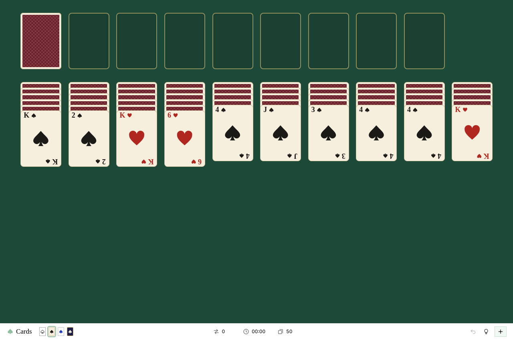

# Cards


Klondike and Spider solitaire for Omarchy, built with C++ and Qt Quick. Klondike draws three with no limit on passes; Spider deals in one, two, or four suits. Both play in the four card series.

| | |
| --- | --- |
|  **Phosphor** follows your Omarchy theme |  **Baize** is felt, ivory, and brass |
|  **Riso** prints two inks on paper |  **Nocturne** is gold on a night sky |

## Play



Click a card, then where it goes, or drag it. A double click sends a card to the best place it can go. Once nothing is hidden and the stock is spent, the rest of the cards go home by themselves. The game saves after every move.

**New game** asks which game to deal: Klondike, or Spider in one, two, or four suits. In Spider, suited runs in rank order move together, a row is dealt to every column at once (never onto an empty column), and a finished king-to-ace run in one suit leaves for a home of its own; eight of them win the game.

| Key | Action |
| --- | --- |
| Arrow keys | Move around the table |
| Space / Enter | Pick up or put down |
| F | Send to the best place |
| D | Draw from the stock |
| Escape | Put the cards back |
| H | Hint |
| Ctrl+Z | Undo |
| N | New game |
| 1–4 | Card series |
| ? | Show shortcuts |
| Q | Quit |

## Build

Needs CMake, a C++17 compiler, and Qt 6 base, declarative, SVG, and Wayland.

```bash
bin/build
bin/test
build/cards open
```

`cards inspect` prints the saved game and `cards deal [GAME [SEED]]` prints a fresh one — GAME is `klondike` or `spider`, with `--suits 1|2|4` for spider — both without a display and with `--json` if asked.

## License

MIT
